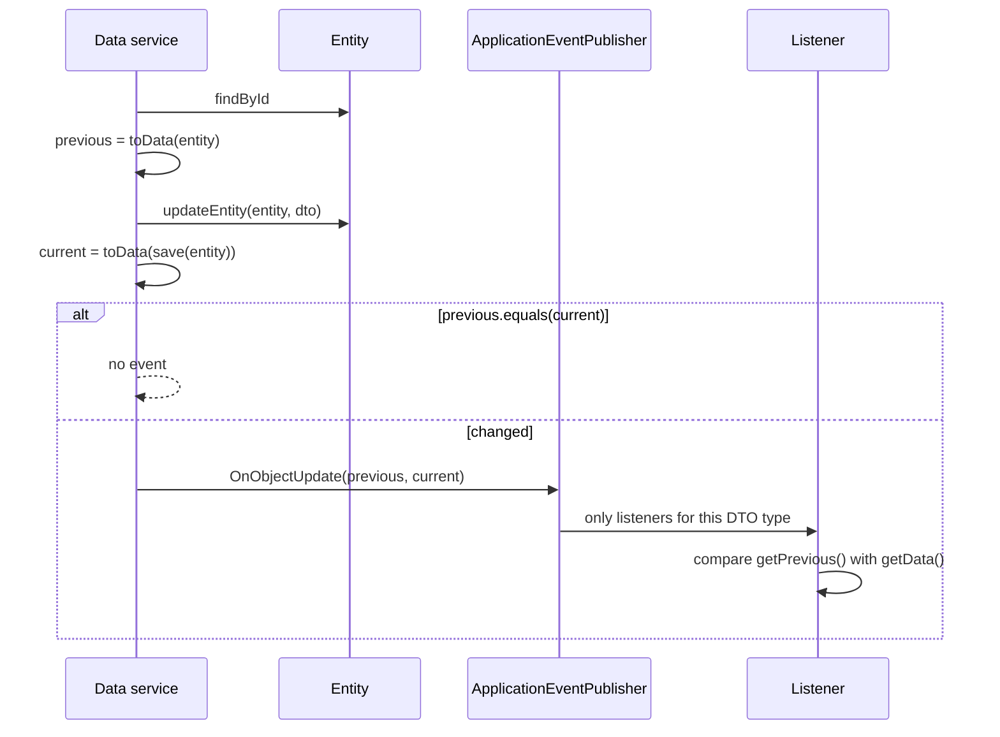

# Design: Previous state on update events

## GitHub Issue

— (origin: [open-tasks#36](https://github.com/OpenElementsLabs/open-tasks/pull/36), which built a
task-specific version of this feature and marked its `change` package as a candidate for
`spring-services`)

## Summary

`OnObjectUpdate` carries only the post-update DTO; its Javadoc says so explicitly — *"The previous
state is not available — listeners that need to compute a diff have to load it themselves."* By the
time a listener runs, it cannot: the row is already updated. open-tasks worked around this with a
hand-written `TaskSnapshot` taken before every `save(...)` and a dedicated `TaskChangedEvent`.

This spec closes the gap in the existing event API instead of next to it. `OnObjectUpdate` learns to
carry the state **before** the update when the publisher knows it, and says honestly when it does
not. `AbstractDbBackedDataService` (and its tenant-aware sibling) capture that state automatically,
and stop publishing updates that changed nothing. What a change *means* — "newly assigned", "moved
column", "description edited" — stays in the application's listener.

Along the way a latent bug in the existing API is fixed: typed listeners such as
`@EventListener OnObjectUpdate<BookDto>` currently receive events for **every** DTO type.

## Goals

- A listener can compare the state before and after an update without loading anything.
- Publishers that cannot know the previous state — an external system, a webhook, a projection —
  keep publishing `OnObjectUpdate` and are first-class citizens, not a degraded special case.
- A listener can always tell the two situations apart; "previous unknown" never looks like
  "nothing changed".
- Updates that change nothing do not produce an event.
- Typed listeners receive only events of their own DTO type, as the package Javadoc already promises.

## Non-goals

- **No diff in the event.** No `PropertyChange`, no `getChanges()`. Comparing two DTOs is a one-liner
  for the listener that needs it and the meaning of a change is domain knowledge. Keeping it out
  keeps the event a plain value carrier (decided in review of the first draft).
- **No actor in the event.** Who made the change is resolved by the listener through `AuthService`,
  exactly as `AuditLogEventListener` does — it runs on the publishing thread, also for
  `@TransactionalEventListener(AFTER_COMMIT)`.
- **No notification delivery, debounce or recipient logic.** That is open-tasks' `notification`
  package and stays application code.
- **No new event type** for "a related object changed" (open-tasks' `COMMENT` change). A new comment
  already publishes `OnObjectCreate<CommentDto>`; the application maps it.

## Technical approach

### `OnObjectUpdate`

```java
public class OnObjectUpdate<T extends WithId> extends GenericDataEvent<T> {

  /** Previous state unknown — e.g. the data comes from an external system. */
  public OnObjectUpdate(@NonNull T current)

  /** Previous state known. Both DTOs must be of the same class and carry the same id. */
  public OnObjectUpdate(@NonNull T previous, @NonNull T current)

  public boolean isPreviousKnown()
  @NonNull public Optional<T> getPrevious()
}
```

- The one-argument constructor is unchanged; every existing publisher keeps compiling and behaving
  as before (`isPreviousKnown() == false`).
- The two-argument constructor rejects `null`, a `previous` of a different class
  (`IllegalArgumentException`) and a `previous` with a different id (`IllegalArgumentException`) —
  an update event comparing two different objects is a programming error, not data.
- The event does **not** decide whether something changed. A publisher may send an event whose
  `previous` equals `current`; suppressing no-ops is the data service's job (below), because only it
  knows the event comes from a save.

### `AbstractDbBackedDataService`

```java
final E entity = getRepository().findById(data.id()).orElseThrow(...);
final D previous = toData(entity);        // snapshot BEFORE updateEntity mutates the entity
updateEntity(entity, data);
final D saved = toData(getRepository().save(entity));
postUpdate(previous, saved);
```

The hooks change from `postSave(boolean insert, D data)` to two methods:

```java
protected void postInsert(@NonNull D data)                       // publishes OnObjectCreate
protected void postUpdate(@NonNull D previous, @NonNull D current) // publishes OnObjectUpdate(previous, current)
```

`postUpdate` publishes nothing when `previous.equals(current)` (logged at `DEBUG`) or when the
service was constructed with `publishEvents == false`.

`AbstractMultitenantDbBackedDataService` gets the same snapshot, the same two hooks and the same
no-op rule. Its update branch also loses a duplicated `getRepository().save(entity)` call.

### `GenericDataEvent` implements `ResolvableTypeProvider`

```java
@Override
public ResolvableType getResolvableType() {
  return ResolvableType.forClassWithGenerics(getClass(), ResolvableType.forClass(getType()));
}
```

Without it Spring cannot see `T` on an event instance (erasure) and treats the unresolvable generic
as a wildcard, so `@EventListener OnObjectUpdate<BookDto>` is invoked for an
`OnObjectUpdate<AuthorDto>` too — and fails with a `ClassCastException` on `getData()`. Verified with
a probe test before this spec was written. `forClassWithGenerics` requires the event class to declare
exactly one type parameter, which holds for all three concrete events; an application subclass that
fixes `T` (`class BookUpdated extends OnObjectUpdate<BookDto>`) has none, so the provider falls back
to `ResolvableType.forClass(getClass())` in that case.



## Design decisions and rationale

### D1: `Optional` plus `isPreviousKnown()`, not a nullable getter or a subclass

`Optional<T> getPrevious()` makes the unknown case impossible to overlook; `isPreviousKnown()` reads
better in a guard clause than `getPrevious().isPresent()`. A subclass (`OnObjectUpdateWithPrevious`)
was considered and rejected: listeners for `OnObjectUpdate<T>` would still get both, so they would
need an `instanceof` — the same check, with a second public type to learn.

### D2: No diff in the event

A first draft carried `List<PropertyChange> getChanges()` computed reflectively over record
components. It was dropped: it ties the event API to records, adds reflection and a JPMS `opens`
requirement, and still could not express what a change means. A listener that needs per-property
changes compares `previous.title()` with `current.title()` — typed, without reflection.

### D3: No-op updates are suppressed in the data service, by `equals`

An update that changes nothing is noise for every listener — audit log, webhooks, notifications.
`equals` is the right comparison because it is what the DTO declares as identity of state; for
records it is a deep comparison for free. A non-record DTO without `equals` falls back to identity,
so its two snapshots are never equal and the event is always published — the safe direction.

Audit timestamps are not a problem: Hibernate only advances `@UpdateTimestamp` on a dirty entity, so
a genuine no-op produces equal DTOs.

### D4: `postSave(boolean, D)` is replaced, not kept

The update path now needs the previous state, which `postSave(false, data)` cannot receive. Keeping
`postSave` but no longer calling it for updates would silently stop running subclass overrides; keeping
it and also calling `postUpdate` would publish twice or let overrides that suppress events stop
working. Removing it makes every affected subclass fail to compile at its `@Override` — a loud
break, documented in the 1.5.0 upgrade guide, instead of a silent one.

### D5: `toData` must return a snapshot

`previous` is produced from the managed entity before `updateEntity` mutates it. If `toData` hands a
mutable collection of the entity to the DTO (instead of `List.copyOf(...)`), `previous` changes with
the entity, compares equal to `current`, and the update is swallowed by D3. This is the reason
open-tasks needed `TaskSnapshot`. The rule goes into the Javadoc of `toData` and of `OnObjectUpdate`;
all `toData` implementations in this repository are flat records of immutable values and comply.

### D6: The generics fix ships with this spec

The feature is only useful through typed listeners, and those are broken today. The fix is one
method and does not change any listener that already filters by `getType()`.

## Security considerations

`previous` holds the same fields as `current`; nothing reaches a listener that it could not already
see. Applications that forward events outward (webhooks, notifications) must decide which fields of
`previous` to include — open-tasks deliberately omits description content. `WebhookEventListener`
serialises only `getData()` and is unchanged.

## Data protection (GDPR / DSGVO)

The previous state may contain personal data that the update just removed (an old e-mail address).
It lives only in memory for the duration of event dispatch and is not persisted by the library. A
listener that stores it is responsible for that copy.

## Testing strategy

- Unit tests for `OnObjectUpdate`: both constructors, rejection of `null`, foreign class and foreign
  id; `getPrevious()` / `isPreviousKnown()` in both cases.
- Unit test for `GenericDataEvent.getResolvableType()` and a Spring-context test proving a typed
  listener ignores events for other DTO types (the probe that found the bug, made permanent).
- Unit tests for `AbstractDbBackedDataService`: update publishes previous and current; no-op update
  publishes nothing; `publishEvents == false` still publishes nothing.
- The same update / no-op pair for `AbstractMultitenantDbBackedDataService`.
- Existing integration tests (audit log, webhooks, `AbstractDbBackedDataServicePublishEventsTest`)
  keep passing; the latter is adjusted where it relied on an update without changes.

## Dependencies

None. `ResolvableTypeProvider` is part of `spring-core`.

## Migration / impact on existing applications

- **Source break** for subclasses of `AbstractDbBackedDataService` /
  `AbstractMultitenantDbBackedDataService` that override `postSave(boolean, D)`: split into
  `postInsert(D)` and `postUpdate(D, D)`.
- **Behaviour change:** an update that changes nothing no longer publishes `OnObjectUpdate`, so it no
  longer creates an audit row or fires a webhook.
- **Behaviour change (bug fix):** typed listeners stop receiving events for other DTO types.
  Listeners on `GenericDataEvent<?>` or a raw type are unaffected.
- No schema change, no configuration.

## Open questions

None.
