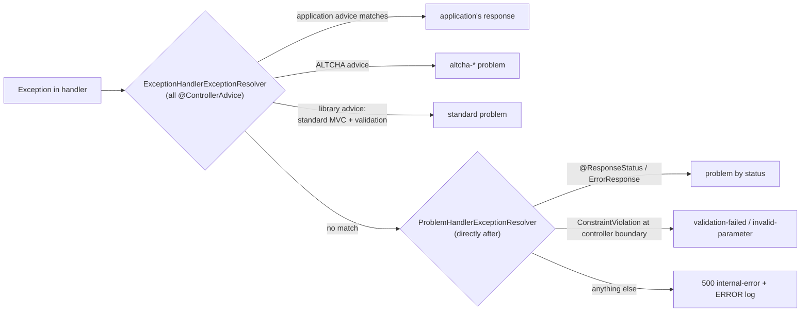

# Design: Problem details for error responses

## Summary

Every error response that spring-services produces or influences — security 401/403, validation, malformed
requests, unhandled exceptions, container errors, ALTCHA — becomes an RFC 9457 problem
(`application/problem+json`) built on Spring's `ProblemDetail`. Each problem carries a stable `type` URI
(configurable base + kebab-case slug) and a `traceId` that also appears in the log MDC. Body validation
failures list field errors as JSON pointers in the JSON names of the request. The format follows the GovStack
API Design Guide, chapter 11, so applications can implement GovStack building blocks without an error layer of
their own. SCIM keeps its RFC 7644 envelope. `openelements.problem-details.enabled=false` restores the previous
behaviour.

## GitHub Issue

[#60 — Unified error responses with RFC 9457 Problem Details](https://github.com/OpenElementsLabs/spring-services/issues/60)

The issue predates the design discussion. Where this document differs from it — no `legacy-fields`, no version
numbers, one form for parameter errors, a minimal trace ID only — this document wins.

## Goals

- All non-SCIM error responses are RFC 9457 problems with `Content-Type: application/problem+json`, across the
  whole application, not only for library endpoints.
- Every problem has `type`, `title`, `status` and `traceId`; `detail` and `instance` where available.
- `type` = configurable base URI + stable slug. Clients compare the full `type` URI.
- Applications produce typed problems by throwing `ProblemException`, without writing a handler, and keep
  full control through their own `@ExceptionHandler`s.
- Body validation errors carry `errors: [{ "pointer", "message" }]` with pointers in the JSON names of the
  request body.
- The same trace ID appears in the problem and in the log MDC; a valid incoming W3C `traceparent` is honoured.
- An unexpected exception never leaks its message, a stack trace, SQL or class names to the client.
- Responses are valid against `Problem` / `ValidationProblem` of the GovStack common API components.

## Non-goals

- Changing the SCIM error format, including the SCIM 401 (`ScimAuthenticationEntryPoint` already answers with
  an RFC 7644 envelope).
- Tracing beyond a minimal trace ID: no `traceresponse` header, no tracing switch, no Micrometer bridge, no
  switch for trusting incoming `traceparent` (see `docs/TODO.md`, "request tracing").
- Localising `title`. It stays English and stable. `detail` may be localised by whoever produces it (ALTCHA
  does).
- A registry that maps foreign exceptions to problem types, and a global problem customizer (see
  `docs/TODO.md`).
- HTML error pages. Backends built on spring-services do not serve HTML.
- A GovStack "profile". There is one behaviour, and it is GovStack-compatible.
- Making `type-base` a required property (see `docs/TODO.md`).

## Compatibility

This is a **deliberate breaking change in a minor release**: with default configuration every error response
changes its content type from `application/json` to `application/problem+json`, and the bodies change shape:

| Source | Before | After |
|---|---|---|
| 401 on JWT, external API-key and MCP chains | `{status, error, message}` | problem `unauthorized` |
| 403 (deactivated user, method security, `denyAll`) | Spring default, empty body | problem `forbidden` |
| ALTCHA verification failure (400) | `{code, message}` | problem `altcha-missing` / `altcha-invalid` / `altcha-expired` |
| Bean Validation on request bodies (400) | Spring Boot default | problem `validation-failed` with `errors[]` |
| Unhandled exception (500) | `BasicErrorController` JSON | problem `internal-error` |
| SCIM | RFC 7644 `Error` | unchanged |

There are no compatibility fields: the old `error`/`message` members and ALTCHA's `code` are gone. A client
that keyed on ALTCHA's `code` compares the full `type` URI instead.

`openelements.problem-details.enabled=false` restores the previous behaviour completely: same status, same
content type, same set of members as before the feature. The trace filter keeps running either way.

The release notes and the upgrade guide of the release that ships this spec must state the content-type
change and show before/after bodies. No schema migration.

## Technical approach

### Packages

Following the layout of `com.openelements.spring.base.info` (API and auto-configuration in one package):

```
com.openelements.spring.base.problem/
├── ProblemType                       API  interface: slug, status, title; ProblemType.of(...)
├── StandardProblemType               API  enum implements ProblemType (frozen slug table)
├── ProblemException                  API  RuntimeException carrying a ProblemType
├── ProblemFactory                    API  interface: the only builder of ProblemDetail
├── ProblemDetailsProperties          API  openelements.problem-details.*
├── ProblemDetailsAutoConfiguration
├── DefaultProblemFactory                  package-private
├── ProblemDetailsExceptionHandler         @RestControllerAdvice, extends ResponseEntityExceptionHandler
├── ProblemHandlerExceptionResolver        package-private; catch-all HandlerExceptionResolver
├── ProblemErrorController                 replaces BasicErrorController
├── ProblemAuthenticationEntryPoint        used by SecurityConfig
├── ProblemAccessDeniedHandler             used by SecurityConfig
├── ProblemResponseWriter                  writes a ProblemDetail to a raw HttpServletResponse
└── JsonPointers                           package-private; Bean Validation path → JSON pointer via Jackson
com.openelements.spring.base.trace/
├── TraceIdResolver                   API  interface
├── TraceContext                      API  static accessor for the current request's trace ID
├── TraceAutoConfiguration
├── TraceParentTraceIdResolver             package-private; default resolver
└── TraceContextFilter                     package-private
```

Classes are package-private wherever Spring and `SecurityConfig` allow it. Both auto-configurations are
registered in core's `AutoConfiguration.imports`, like `ApplicationInfoAutoConfiguration`, and are
`@ConditionalOnWebApplication(type = SERVLET)`.

### Configuration

```properties
openelements.problem-details.enabled=true             # default true
openelements.problem-details.type-base=https://open-elements.com/problems/spring-services/
openelements.problem-details.include-instance=true    # request path, never the query string
```

`type-base` must be an absolute URI whose path ends with `/`; otherwise start-up fails with a message naming the
property. It applies to **all** types — the library's and the application's. An application that sets its own
base (e.g. `https://govstack.global/problems/registries/`) gets the library's types under that base too.

**Rationale for the default:** a dereferenceable Open Elements URL was kept for now; a required property without
default is the clean variant but is itself a breaking change that needs documentation pages first (TODO).

### `ProblemType`

```java
public interface ProblemType {
  String slug();          // ^[a-z][a-z0-9]*(-[a-z0-9]+)*$
  HttpStatus status();    // 4xx or 5xx
  String title();         // non-blank, English, stable

  static ProblemType of(String slug, HttpStatus status, String title);
}
```

`ProblemType.of` validates all three and throws `IllegalArgumentException` (`NullPointerException` for
`null`). Applications define types as an enum implementing `ProblemType` or as `ProblemType.of` constants.

**Rationale:** the issue proposed a record. An interface lets the library ship a frozen enum and lets
applications choose enums or constants; a record could not be an enum.

### `StandardProblemType`

A frozen enum with **one entry per error status of RFC 9110** (plus the registered extensions 423, 424, 425,
428, 429, 431, 451, 507, 508, 511) and four special types.

Two RFC 9110 statuses are left out. `418` is listed as unused by §15.5.19. `421 Misdirected Request`
has no `HttpStatus` constant in Spring Framework 6 — it is a connection-level status produced by a
reverse proxy, not by a request handler — and `ProblemType.status()` returns `HttpStatus`, so the enum
cannot name it without inventing a constant. Both reach `forStatus(int)` and resolve to the synthesised
`http-<code>` type, which is exactly the behaviour `behaviors.md` pins for `418`.

The table:

| Slug | Status | Title |
|---|---|---|
| `bad-request` | 400 | Bad Request |
| `unauthorized` | 401 | Unauthorized |
| `forbidden` | 403 | Forbidden |
| `not-found` | 404 | Not Found |
| `method-not-allowed` | 405 | Method Not Allowed |
| `not-acceptable` | 406 | Not Acceptable |
| `conflict` | 409 | Conflict |
| `gone` | 410 | Gone |
| `content-too-large` | 413 | Content Too Large |
| `unsupported-media-type` | 415 | Unsupported Media Type |
| `unprocessable-content` | 422 | Unprocessable Content |
| `too-many-requests` | 429 | Too Many Requests |
| `internal-error` | 500 | Internal Server Error |
| `bad-gateway` | 502 | Bad Gateway |
| `service-unavailable` | 503 | Service Unavailable |
| `gateway-timeout` | 504 | Gateway Timeout |
| … | … | (the remaining 4xx/5xx codes, RFC 9110 names in kebab case) |
| `validation-failed` | 400 | Validation failed |
| `malformed-request` | 400 | Malformed request |
| `invalid-parameter` | 400 | Invalid parameter |

`StandardProblemType.forStatus(int)` returns the status entry (400 → `bad-request`, 500 → `internal-error`). A
status without an entry yields a type with slug `http-<code>` and title `HTTP <code>`.

**Rationale:** slugs are public contract because clients compare `type` URIs. Deriving them from Spring's
`HttpStatus` constants at runtime would silently change them on a Spring upgrade (Spring 6 renamed
`PAYLOAD_TOO_LARGE` → `CONTENT_TOO_LARGE`, `UNPROCESSABLE_ENTITY` → `UNPROCESSABLE_CONTENT`). The enum freezes
them. Base names follow RFC 9110, not Spring.

ALTCHA types live in the ALTCHA module as `AltchaProblemType implements ProblemType` (`altcha-missing`,
`altcha-invalid`, `altcha-expired`, all 400), so core knows no slugs of optional modules.

### `ProblemException`

```java
public class ProblemException extends RuntimeException {
  public ProblemException(ProblemType type);
  public ProblemException(ProblemType type, @Nullable String detail);
  public ProblemException(ProblemType type, @Nullable String detail, Map<String, ?> properties);

  public ProblemType type();
  public Optional<String> detail();
  public Map<String, Object> properties();   // immutable copy
}
```

- Not final; applications may subclass it for domain exceptions.
- `properties` become extension members of the problem. Keys reserved by the library — `type`, `title`,
  `status`, `detail`, `instance`, `traceId`, `errors` — throw `IllegalArgumentException` in the constructor.
  `null` keys or values throw `NullPointerException`.
- `getMessage()` returns the detail, or the title if there is none.

### `ProblemFactory`

The only place that builds `ProblemDetail` objects; used by the MVC advice, the exception resolver, the error
controller, the security handlers (which run outside MVC) and the ALTCHA handler. Applications inject it to
build problems in their own handlers.

```java
public interface ProblemFactory {
  ProblemDetail create(ProblemType type, @Nullable String detail, HttpServletRequest request);
  ProblemDetail create(ProblemException exception, HttpServletRequest request);
}
```

It sets `type` (base + slug), `title`, `status`, `detail`, `instance` (if enabled: `request.getRequestURI()`, or
the original URI on an error dispatch; never the query string), `traceId` (from `TraceContext`) and the
exception's extension members. `DefaultProblemFactory` is registered `@ConditionalOnMissingBean(ProblemFactory.class)`.

### Exception handling in Spring MVC



**`ProblemDetailsExceptionHandler`** — `@RestControllerAdvice`, `@Order(Ordered.LOWEST_PRECEDENCE)`, extends
`ResponseEntityExceptionHandler`, registered `@ConditionalOnMissingBean(ResponseEntityExceptionHandler.class)`.
It handles only Spring MVC's standard exceptions and validation:

| Exception | Problem |
|---|---|
| `MethodArgumentNotValidException` | `validation-failed`, `errors[]` from the body |
| `HandlerMethodValidationException` | see "Validation" below |
| `HttpMessageNotReadableException` | `malformed-request`, generic detail, no parser message |
| `MethodArgumentTypeMismatchException`, `MissingServletRequestParameterException`, `MissingRequestHeaderException` | `invalid-parameter`, parameter name and location in `detail`, value never echoed |
| `AccessDeniedException` (incl. `AuthorizationDeniedException`) | `forbidden`, exception message as detail |
| any other standard MVC exception (`ErrorResponse`) | `StandardProblemType.forStatus(status)`; headers such as `Allow` kept |

**`ProblemHandlerExceptionResolver`** — the catch-all. Added via `WebMvcConfigurer.extendHandlerExceptionResolvers`
**directly after** `ExceptionHandlerExceptionResolver`, so every `@ExceptionHandler` of the application — with or
without `@Order` — is tried first. It resolves:

1. Exceptions annotated with `@ResponseStatus` → that status, `reason` (if any) as `detail`.
2. `ErrorResponse` / `ResponseStatusException` not already handled → its status, its `reason` as `detail`.
3. `ConstraintViolationException` whose violations all belong to the current handler method → treated as
   controller-boundary validation (see below). Any other `ConstraintViolationException` (a `@Validated`
   service deeper down) → `500 internal-error`.
4. Anything else → `500 internal-error` with the fixed detail `An unexpected error occurred.`

Every problem with status ≥ 500 is logged at `ERROR` with the exception and the trace ID in the MDC; 4xx
problems are logged at `DEBUG`.

**Rationale (catch-all as a resolver, not in the advice):** a `@RestControllerAdvice` without `@Order` has
`LOWEST_PRECEDENCE`, the same as the library's; the winner on a tie depends on bean registration order, which is
not a contract. As a resolver after `ExceptionHandlerExceptionResolver`, the catch-all can never shadow an
application handler. It also fixes a trap in the issue's design: a `@ExceptionHandler(Exception.class)` runs
before `ResponseStatusExceptionResolver` and would turn every `@ResponseStatus` exception into a 500.

**Overriding a standard MVC exception:** an application advice that handles, say,
`MethodArgumentNotValidException` competes with the library advice at equal order. The documentation tells
applications to give such an advice an `@Order` (or to extend `ResponseEntityExceptionHandler` themselves, in
which case the library advice backs off entirely and only the catch-all remains).

**Interplay with Spring Boot:** Boot's own `ProblemDetailsExceptionHandler` (`spring.mvc.problemdetails.enabled`)
is `@ConditionalOnMissingBean(ResponseEntityExceptionHandler.class)`; `ProblemDetailsAutoConfiguration` runs
before `WebMvcAutoConfiguration` and `ErrorMvcAutoConfiguration`, so Boot's handler and `BasicErrorController`
back off.

### Validation

**Body errors** (`MethodArgumentNotValidException`, and `ParameterErrors` of a `@RequestBody` inside a
`HandlerMethodValidationException`) become `errors[]` entries `{ "pointer", "message" }`:

- The pointer is built from the Bean Validation property path (`FieldError.unwrap(ConstraintViolation.class)`),
  resolving each property name through Jackson's `BeanDescription` of the current type, so `@JsonProperty`
  and the configured `PropertyNamingStrategy` apply: `address.postalCode` → `/address/postal_code`.
- Indexes and map keys become pointer segments: `items[0].name` → `/items/0/name`; keys are escaped per
  RFC 6901 (`~` → `~0`, `/` → `~1`).
- A class-level constraint on the body root yields the pointer `""` (whole document); on a nested object, the
  pointer of that object.
- If a type cannot be introspected, the Java property name is used for that segment.
- `message` is the interpolated Bean Validation message. Rejected values are never included by the library.
  A message template using `${validatedValue}` would echo the value; this is the developer's responsibility and
  is documented.

**Parameter errors** (`@RequestParam`, `@PathVariable`, `@RequestHeader`) do **not** go into `errors[]`. Guide
§11.4 allows a building block to describe invalid parameters in `detail` without an `errors` array; the
GovStack `FieldError` requires a `pointer`, which parameters do not have.

| Errors present | Problem |
|---|---|
| body only | `validation-failed`, `errors[]` |
| parameters only | `invalid-parameter`, no `errors[]`, `detail` lists each parameter |
| body and parameters | `validation-failed`, `errors[]` with body entries, `detail` lists the parameters |

`detail` format for parameters: `Invalid query parameter 'size': must be less than or equal to 100.` — one
sentence per parameter, joined by a space, in parameter declaration order. The location is `query`, `path` or
`header`.

**Controller boundary only:** a `ConstraintViolationException` is a 400 only if all violations have the
current handler's bean as root bean and the handler method as executable (a controller annotated with
`@Validated`). Violations from service methods deeper down are programming errors → 500.

### Security handlers

- **`ProblemAuthenticationEntryPoint(ProblemFactory, ProblemResponseWriter, String wwwAuthenticate)`** replaces
  `JsonAuthenticationEntryPoint` in the beans `jwtAuthenticationEntryPoint` and `apiKeyAuthenticationEntryPoint`.
  The bean methods return `AuthenticationEntryPoint`; `McpSecurityConfig` already injects that type by qualifier
  and needs no change. The `WWW-Authenticate` header stays chain-specific (`Bearer`, `ApiKey realm="external"`).
  `detail` is the `AuthenticationException` message, as `message` was before.
- **`ProblemAccessDeniedHandler`** — new, wired via `exceptionHandling(e -> e.accessDeniedHandler(...))` into
  the external and default chains. `detail` is the `AccessDeniedException` message.
- **Error dispatch:** the default chain permits `DispatcherType.ERROR`, so a `sendError` from a filter or the
  container reaches `ProblemErrorController` even for an anonymous request instead of being turned into a 401.
- With `enabled=false`, `SecurityConfig` registers `JsonAuthenticationEntryPoint` as before, no access-denied
  handler and no error-dispatch permit. The choice is made with `@ConditionalOnProperty` on the bean methods.
- `JsonAuthenticationEntryPoint` stays as the `enabled=false` implementation.

### `ProblemErrorController`

Implements `ErrorController` on `${server.error.path:/error}`; registered `@ConditionalOnMissingBean(ErrorController.class)`.
Always answers `application/problem+json`, regardless of `Accept`. It takes the status from
`jakarta.servlet.error.status_code`, the type from `StandardProblemType.forStatus`, and `instance` from
`jakarta.servlet.error.request_uri`. It sets no `detail`: container and `sendError` messages are not curated.

### ALTCHA

`AltchaExceptionHandler` receives an `ObjectProvider<ProblemFactory>`. When a factory is present, it answers with
the `AltchaProblemType` for the verification result and the localised message as `detail`. Without one
(`enabled=false`), it answers `{code, message}` as before.

### Trace ID (minimal)

```java
public interface TraceIdResolver {
  String resolve(HttpServletRequest request);   // 32 lowercase hex characters, not all zero
}
```

- **`TraceParentTraceIdResolver`** (default, `@ConditionalOnMissingBean(TraceIdResolver.class)`) takes the
  trace-id field of a single valid `traceparent` header (W3C Trace Context Level 1: version ≠ `ff`, 32 lowercase
  hex trace-id not all zero, 16 hex parent-id not all zero, 2 hex flags, no trailing data for version `00`).
  Otherwise, it generates one: 16 bytes from `SecureRandom`, lowercase hex, regenerated if all zero.
- **`TraceContextFilter`** — `OncePerRequestFilter`, registered via `FilterRegistrationBean` with order
  `SecurityProperties.DEFAULT_FILTER_ORDER - 1`, so it runs before every security filter chain. It resolves the
  ID once per request and stores it as a request attribute and in the MDC under `traceId`, and removes the MDC
  entry in `finally`. Always active in a servlet web application; independent of `problem-details.enabled`.
- **`TraceContext.traceId(HttpServletRequest)`** returns the stored ID, or resolves (and stores) one if the
  filter did not run (e.g. a MockMvc test without filters).

## Response examples

401, external chain:

```http
HTTP/1.1 401 Unauthorized
Content-Type: application/problem+json
WWW-Authenticate: ApiKey realm="external"

{
  "type": "https://open-elements.com/problems/spring-services/unauthorized",
  "title": "Unauthorized",
  "status": 401,
  "detail": "Invalid API key",
  "instance": "/api/external/contacts",
  "traceId": "4bf92f3577b34da6a3ce929d0e0e4736"
}
```

400, body and parameter validation:

```json
{
  "type": "https://govstack.global/problems/registries/validation-failed",
  "title": "Validation failed",
  "status": 400,
  "detail": "Invalid query parameter 'dryRun': must not be null.",
  "instance": "/api/registries/persons",
  "traceId": "4bf92f3577b34da6a3ce929d0e0e4736",
  "errors": [
    { "pointer": "/address/postal_code", "message": "must match \"[0-9]{5}\"" }
  ]
}
```

409, application type with extension member:

```json
{
  "type": "https://open-elements.com/problems/spring-services/duplicate-contact",
  "title": "Duplicate contact",
  "status": 409,
  "detail": "A contact with this e-mail address already exists",
  "instance": "/api/contacts",
  "traceId": "4bf92f3577b34da6a3ce929d0e0e4736",
  "existingContactId": "0b6f3c1e-8d9a-4a57-9a43-1b0d1f3e7c21"
}
```

## Key flows

```mermaid
sequenceDiagram
    participant C as Client
    participant T as TraceContextFilter
    participant S as Security chain
    participant M as Spring MVC
    participant F as ProblemFactory
    C->>T: request (+ optional traceparent)
    T->>T: resolve traceId → request attribute + MDC
    T->>S: continue
    alt authentication fails
        S->>F: ProblemAuthenticationEntryPoint
        F-->>C: 401 problem+json (traceId)
    else handler throws
        S->>M: continue
        M->>M: application advice? library advice? catch-all resolver
        M->>F: create(type, detail, request)
        F-->>C: problem+json (traceId); 5xx logged at ERROR with MDC traceId
    end
    T->>T: clear MDC
```

## Security and privacy

- `detail` comes only from: `ProblemException`, the `reason` of `@ResponseStatus` / `ResponseStatusException`,
  `AuthenticationException` and `AccessDeniedException` messages (as before), ALTCHA's curated messages, and
  Bean Validation messages. Developers are responsible for keeping personal data out of these. Unexpected
  exceptions never contribute text.
- Rejected values, parser messages and type-mismatch values are never echoed.
- `instance` never contains the query string, which may carry personal data.
- The trace ID is validated as hex, so a client-supplied `traceparent` cannot inject into logs. A client can,
  however, choose its trace ID; making that configurable is deferred to the tracing spec.
- Permitting `DispatcherType.ERROR` exposes only the problem rendering of `/error`, never a handler.

## Testing

- Unit tests: `ProblemType.of` validation, `StandardProblemType.forStatus`, `ProblemException` reserved keys,
  `JsonPointers` (naming strategy, `@JsonProperty`, indexes, map keys, escaping, class-level), traceparent
  parsing.
- Web slice / integration tests in core with a test controller covering each row of the mapping tables, both
  security chains, `enabled=false`, and an application advice overriding the library.
- ALTCHA module test for the three types and for `enabled=false`.
- **GovStack contract test** — `src/test/resources/govstack/govstack-openapi-common.yaml` (test scope only), with
  a README recording provenance:

  | Field | Value |
  |---|---|
  | Source | https://github.com/jeremi/govstack-api-common, `openapi/govstack-openapi-common.yaml` |
  | Version | `0.1.0-draft` (unratified incubation artifact) |
  | Commit | `12b9b1acde9bfaa5a77e26380fa8f9e1f29bb28e` (branch `agent/close-component-lint-gaps`, not on `main`) |
  | SHA-256 | `05d1bfc89c86a8d64005e343268326b3fb43cd044fe30f662fec0f9f573b0c73` |
  | Licence | Apache-2.0 (licence notice kept next to the file) |

  The version string alone does not identify the file: `main` carries a different `0.1.0-draft` that requires
  `code` and `timestamp`, which contradicts API Design Guide §11.2/§11.4. The test verifies the SHA-256 before
  running. The normative source is the Guide, chapter 11; the artifact is an optional schema companion (§2.8).

  Run with `type-base=https://govstack.global/problems/test/`:
  - every body-validation response validates against `ValidationProblem`;
  - every other error response, including parameter errors, validates against `Problem`;
  - beyond the schema (which allows extra members): no problem contains `timestamp`, `error`, `message` or
    `code`, and no `errors[]` entry contains `code`;
  - `traceId` equals the trace-id of the request's `traceparent` when one was sent (Guide §11.3).

## Documentation

- README: replace the "Uniform Authentication-Failure Responses" paragraph with a "Problem details" section
  (properties, types, how to throw `ProblemException`, how to override, `@Order` advice note,
  `${validatedValue}` warning, "no HTML" constraint).
- Upgrade guide and release notes of the shipping release: content-type change, before/after bodies,
  ALTCHA `code` → `type`, `enabled=false`.
- `package-info.java` for both new packages.

## Dependencies

- No new runtime dependency: `ProblemDetail`, `ResponseEntityExceptionHandler` and Jackson are already present.
- Test scope: a JSON Schema / OpenAPI validator for the contract test; the concrete library is chosen during
  implementation and pinned in the BOM-managed test dependencies.

## Open questions

- None blocking. Deferred items are recorded in `docs/TODO.md`: request tracing, required `type-base`,
  exception mapping registry / customizer, merging the pinned GovStack schema upstream.
