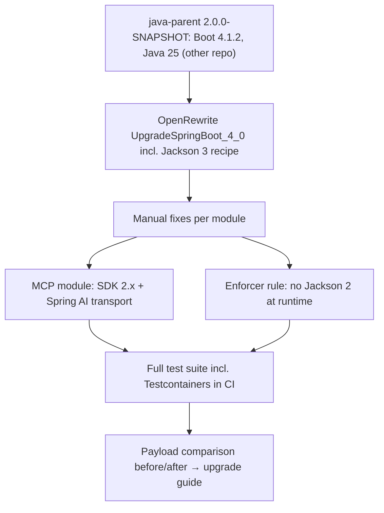

# Design: Upgrade to Spring Boot 4

## Summary

The whole reactor moves from Spring Boot 3.5 to Spring Boot 4.1 (Spring Framework 7.0, Spring Security 7.1,
Hibernate ORM 7.4, Jackson 3.1, Jakarta EE 11) and `main` becomes `2.0.0-SNAPSHOT`. It is a platform upgrade
only: no library feature changes and no library-motivated breaking changes. The only breaks are the ones the
platform forces — Jackson 3 types in public signatures and changed JSON defaults. The MCP module moves to MCP
SDK 2.x with the WebMVC transport from Spring AI. An enforcer rule keeps Jackson 2 out of every module's
runtime tree.

## GitHub Issue

[#58 — Upgrade to Spring Boot 4 (Spring Framework 7, Security 7, Hibernate 7, Jackson 3)](https://github.com/OpenElementsLabs/spring-services/issues/58)

The issue is the starting point; where it differs from this document (release strategy, Java baseline,
null-safety work, consumer migration), this document wins — see Non-goals.

## Prerequisite

A **`java-parent` version that manages Spring Boot 4.1.x**. Available as **`java-parent` 2.0.0-SNAPSHOT**
([java-parent#9](https://github.com/OpenElementsLabs/java-parent/pull/9), java-parent spec 004). It manages:

| Property | 1.3.0 | 2.0.0-SNAPSHOT |
|---|---|---|
| `spring-boot.version` | 3.5.14 | 4.1.2 |
| `springdoc.version` / `swagger.version` / `swagger-ui.version` | 2.8.17 / 2.2.47 / 5.32.2 | 3.2.0 / 2.2.55 / 5.34.0 |
| `jspecify.version` | 1.0.0 | 1.0.1 |
| `testcontainers.version` | 2.0.5 | 2.0.5 |
| `maven.compiler.source`/`target`, `enforcer.requiredJavaVersion` | 21 | **25** |

spring-services does **not** override any of these: a property of the same name would shadow the parent's and
silently pin its BOM import (see the comment in the root `pom.xml`). The Java baseline is that parent's decision:
**Java 25**.

The migration is developed against the snapshot. Releasing spring-services 2.0.0 requires the released
`java-parent` 2.0.0 (a release cannot depend on a snapshot parent); that switch is part of the release, not of
this spec. It consists of three edits in the root `pom.xml`: the parent version, and removing the temporary
Central snapshot `<repositories>` block together with `checker.strict=false` — Maven needs the repository to
resolve the snapshot parent, and pomchecker's strict mode (Maven Central rules) rejects a `<repositories>` block.

## Goals

- Every module builds and every test passes on Spring Boot 4.1.x.
- The library's own code uses Jackson 3 only (`tools.jackson.*`; annotations stay in
  `com.fasterxml.jackson.annotation`).
- No module has Jackson 2 (`com.fasterxml.jackson.core:jackson-databind` / `jackson-core`) in its runtime
  dependency tree, enforced by the build.
- The MCP module runs on MCP SDK 2.x with Spring AI's WebMVC transport and keeps its behaviour.
- `docs/releases/upgrade-to-2.0.md` lists every change a consumer has to make, including the JSON differences
  determined during the migration.

## Non-goals

- Library breaking changes waiting for a major (package cycles, required `type-base`, dropping
  `openelements.problem-details.enabled=false`, …). They stay in `docs/TODO.md` for a later major.
- Release strategy: publishing 2.0.0, a 1.x maintenance branch, its support window.
- Choosing the Java baseline — decided by `java-parent` (25). Using Java 25 language features in the code.
- Null safety work: `@NullMarked` on the remaining packages and NullAway (`docs/TODO.md`). JSpecify is already
  the only null annotation in use; that stays as is.
- Hiding Jackson from the public API.
- Keeping the JSON wire format identical: Jackson 3 / Boot 4 defaults are accepted (see "JSON defaults").
- Permanent snapshot tests of JSON payloads.
- Migrating consumer applications (open-crm, open-tasks, …). That is a release gate outside this spec.

## Already done (no work)

Verified in the code before writing this spec:

| Issue checklist item | State |
|---|---|
| Testcontainers 2.x | `java-parent` (1.3.0 and 2.0.0-SNAPSHOT) manages 2.0.5 — the version Boot 4.1.2 manages; artifacts already use the 2.x names (`testcontainers-postgresql`) |
| `RestClient` everywhere | `TranslationService`, `WebhookSender`, `DbBackupClient`, `MeilisearchClient` already use `RestClient`; no `RestTemplate`/`WebClient` in main code |
| JSpecify | only `org.jspecify.annotations` in use; no `org.springframework.lang` |
| Meilisearch client | own `RestClient`-based client, no third-party SDK |

## Target versions

Verified on Maven Central (2026-11-12):

| Component | Today | Target | Source |
|---|---|---|---|
| Java | 21 | 25 | `java-parent` |
| Spring Boot | 3.5.14 | 4.1.2 | `java-parent` |
| Spring Framework | 6.2.x | 7.0.x (7.0.10 in Boot 4.1.2) | Boot |
| Spring Security | 6.5.x | 7.1.x | Boot |
| Hibernate ORM | 6.6.x | 7.4.x | Boot |
| Hibernate Validator | 8.0.x | 9.1.x | Boot |
| Jackson | 2.19.x | 3.1.x (`tools.jackson`) | Boot |
| MCP SDK | `mcp-spring-webmvc` + `mcp-json-jackson2` 0.18.3 | `mcp-core` + `mcp-json-jackson3` 2.1.0 | root `pom.xml` (`mcp-sdk.version`) |
| MCP WebMVC transport | in the MCP SDK | `org.springframework.ai:mcp-spring-webmvc` 2.0.x | root `pom.xml` (new `spring-ai.version`) |
| networknt `json-schema-validator` (test) | 2.0.0 (Jackson 2) | 3.x (Jackson 3) | root `pom.xml` |

## Technical approach

### Order of work



OpenRewrite's `org.openrewrite.java.spring.boot4.UpgradeSpringBoot_4_0` (including its Jackson 3 recipe) does the
mechanical part. It is run once, locally; the recipe is **not** added to the build. Its output is reviewed
like hand-written code.

### Build and POMs

- Parent: `com.open-elements:java-parent` 1.3.0 → 2.0.0-SNAPSHOT. No version override in spring-services.
- Java 25 everywhere the build runs: `java-version` in `.github/workflows/build.yml`, `snapshot.yml` and
  `release.yml`, and `.sdkmanrc` (`java=21` → `java=25`), matching what java-parent#9 did in its own repo.
- Reactor version: `2.0.0-SNAPSHOT` in all modules, `-all` and `-bom`.
- Starters: follow Boot 4's renames, e.g. `spring-boot-starter-web` → `spring-boot-starter-webmvc`.
  Tests that use slices or MockMvc add the matching Boot 4 test starters (the test auto-configuration moved into
  per-technology modules).
- Root `pom.xml`: `mcp-sdk.version` → 2.1.0, new `spring-ai.version` (2.0.x), `json-schema-validator.version`
  → 3.x. The Jackson YAML test dependency moves to `tools.jackson.dataformat:jackson-dataformat-yaml`.
- `spring-services-core`'s existing `ban-optional-feature-dependencies` rule keeps its content; its
  `io.modelcontextprotocol.sdk:*` entry is joined by `org.springframework.ai:*`, since Spring AI is now an MCP
  feature dependency.

### Enforcer rule: no Jackson 2 at runtime

A `bannedDependencies` rule, configured once in the root `pom.xml` `<build><plugins>` so every module inherits it:

```xml
<bannedDependencies>
  <excludes>
    <exclude>com.fasterxml.jackson.core:jackson-databind</exclude>
    <exclude>com.fasterxml.jackson.core:jackson-core</exclude>
  </excludes>
  <searchTransitive>true</searchTransitive>
  <message>Jackson 2 must not be on the runtime classpath of a spring-services module (spec 025).</message>
</bannedDependencies>
```

- `com.fasterxml.jackson.core:jackson-annotations` stays allowed: Jackson 3 itself uses the 2.x annotations.
- **Scope:** `compile` and `runtime` only. Test-scoped Jackson 2 is not banned, but this spec moves the known
  test usages (networknt validator, YAML) to Jackson 3 anyway.
- **No exceptions list.** If a third-party library needs Jackson 2 at runtime, the affected module blocks 2.0 until
  upstream supports Jackson 3. Checked for this spec: MCP SDK 2.1.0 (Jackson 3 via `mcp-json-jackson3`, its
  networknt validator 3.0.6 is on Jackson 3), Spring AI `mcp-spring-webmvc` 2.0.2 (no Jackson), Slack
  `slack-api-client` 1.45.3 (Gson), AWS SDK 2.x (shaded `third-party-jackson-core`), `swagger-annotations-jakarta`
  (no dependencies). No blocker is known.

### Jackson 3

- All `com.fasterxml.jackson.databind` / `.core` / `.dataformat` imports (27 files) move to `tools.jackson.*`.
- Jackson 3 `ObjectMapper` is immutable; code that configures a mapper uses `JsonMapper.builder()` or
  `mapper.rebuild()`. Beans keep receiving the application's mapper from Boot (Boot 4 provides a `JsonMapper`).
- `JsonProcessingException` (checked) becomes `JacksonException` (unchecked). Catch blocks and `throws`
  clauses are adapted; no behaviour change intended.
- **Public signatures change 1:1** to Jackson 3 types:

  | Class | Signature after the upgrade |
  |---|---|
  | `MeilisearchClient` | `MeilisearchClient(MeilisearchProperties, tools.jackson.databind.ObjectMapper)`, `tools.jackson.databind.JsonNode multiSearch(Map<String, Object>)` |
  | `McpToolSupport` | `McpToolSupport(McpPaging, tools.jackson.databind.ObjectMapper)` |
  | `ProblemResponseWriter` | `ProblemResponseWriter(tools.jackson.databind.ObjectMapper)` |
  | `ScimAuthenticationEntryPoint` | `ScimAuthenticationEntryPoint(tools.jackson.databind.ObjectMapper)` |

  There are no custom serializers, deserializers or Jackson modules in the library.
- `JsonPointers` (spec 024) resolves JSON names through Jackson's `BeanDescription` and naming strategy; the
  Jackson 3 equivalents are used, and its existing tests (naming strategy, `@JsonProperty`) must pass unchanged.

### JSON defaults

Jackson 3 and Boot 4 change defaults that alter JSON output without code changes (e.g. property ordering, date
handling). **They are accepted.** During the migration, the differences are determined **once**:

1. Before the upgrade, capture representative payloads from the existing tests: webhook payload
   (`WebhookSender`), SCIM `User` / `ListResponse` / `Error`, problem details (401, 400 with `errors[]`, 500),
   and the library's REST DTOs (users, API keys, webhooks, application info).
2. Capture the same payloads after the upgrade.
3. Record every semantic difference (field names, value formats, date formats, `null` handling, ordering) in
   `upgrade-to-2.0.md`, with webhook receivers called out separately because they are third parties.

The captures are a migration aid and are not committed as tests.

### Spring Boot 4 auto-configuration

Boot 4 splits `spring-boot-autoconfigure` into per-technology modules; classes the library references move
packages. References to update:

| Used in | Class |
|---|---|
| `SpringServicesCoreAutoConfiguration` | `HibernateJpaAutoConfiguration`, `JpaRepositoriesAutoConfiguration` (`@AutoConfigureBefore`) |
| `ApplicationInfoAutoConfiguration` | `ProjectInfoAutoConfiguration` |
| `ProblemDetailsAutoConfiguration` | `WebMvcAutoConfiguration`, `ErrorMvcAutoConfiguration` (ordering) |
| trace filter | `SecurityProperties.DEFAULT_FILTER_ORDER` |
| email module | `MailSenderAutoConfiguration` |
| tests | `JacksonAutoConfiguration`, `HttpMessageConvertersAutoConfiguration`, `SecurityAutoConfiguration`, `ValidationAutoConfiguration`, `AutoConfigureMockMvc`, `TestRestTemplate` |

The ordering semantics must stay the same: core before JPA, problem details before WebMVC and error MVC (so
Boot's `ProblemDetailsExceptionHandler` and `BasicErrorController` still back off), trace filter before the
security filter chains. `AutoConfiguration.imports` registrations, `@ConditionalOnClass` /
`@ConditionalOnProperty` guards and `@ConfigurationProperties` records are checked against Boot 4 behaviour;
the existing auto-configuration tests are the oracle.

### Spring Security 7

The four chains — SCIM (`@Order(0)`), MCP (`@Order(0)`), external API key (`@Order(1)`), default JWT
(`@Order(2)`) — plus the ALTCHA chain are checked against APIs removed in Security 7. Known areas: the lambda
DSL is already used everywhere; request matchers (`requestMatchers` with path patterns now default to
`PathPatternRequestMatcher`), `dispatcherTypeMatchers` for the error dispatch (spec 024), the JWT authority
mapping in `jwtAuthenticationConverter()`, and `ApiKeyAuthenticationFilter`. Behaviour of every chain stays
identical; the existing security tests are the oracle.

### Hibernate 7 / JPA 3.2 / Jakarta EE 11

- Entities: `@CreationTimestamp` / `@UpdateTimestamp`, `@BatchSize`, the tenant pre-persist guard, the schema
  `oe_spring_services` and the native queries are checked against Hibernate 7 deprecations and removals.
- Flyway migrations are unchanged; no schema change.
- Servlet 6.1: the API-key filter and any request wrappers are checked; no behaviour change.

### MCP module

- Dependencies: `io.modelcontextprotocol.sdk:mcp-core` and `mcp-json-jackson3` 2.1.0,
  `org.springframework.ai:mcp-spring-webmvc` 2.0.x (Spring Framework 7.0.10, matching Boot 4.1.2). Remove
  `mcp-json-jackson2` and the SDK's `mcp-spring-webmvc`.
- Code: adapt `McpServerConfig`, `McpTools`, `McpToolSupport`, `McpToolLogic`, `McpConfiguration` to the 2.x API
  (`McpServer`, `McpSyncServer`, `SyncToolSpecification`, `McpSchema`, `McpTransportContext`) and the transport
  provider class from Spring AI (`WebMvcStreamableServerTransportProvider` or its 2.x successor).
- Behaviour stays the same: same paths (`/mcp`, `/mcp/**`), same tools with the same names, input schemas and
  results, same API-key security chain, same `openelements.mcp.*` properties. Changed transport or protocol
  defaults that are visible to MCP clients go into the upgrade guide.

## Testing

- The full test suite, including the Testcontainers tests, runs in CI on the new baseline before merging.
- Tests are adapted only where the platform forces it (imports, moved test annotations, Jackson 3 types,
  changed exception types). **No test is deleted, disabled or weakened** to make the build green; if a test's
  expectation must change because a platform default changed, the change is listed in the upgrade guide.
- The enforcer rule is verified once by temporarily adding `com.fasterxml.jackson.core:jackson-databind` to a
  module and confirming the build fails (not committed).

## Documentation

- `docs/releases/upgrade-to-2.0.md`: required Java 25, Boot 4.1 and `java-parent` 2.0.0, starter renames for consumers,
  Jackson 3 package change and the four changed public signatures, `JacksonException`, MCP SDK / Spring AI
  dependency, the JSON differences found, changed configuration properties (if any).
  A note on Jackson 2 in consumer applications: spring-services itself is free of Jackson 2 at runtime (only
  `swagger-annotations-jakarta`, which has no dependencies), but springdoc 3.2.0 / swagger-core 2.2.55 managed by
  `java-parent` 2.0.0 still pull in `com.fasterxml.jackson.core:jackson-databind`. Applications using springdoc
  therefore keep Jackson 2 on their classpath next to Jackson 3. That is expected, not a spring-services
  dependency leak, and the two do not conflict (different packages); a consumer-side ban on Jackson 2 like ours
  is not possible while they use springdoc.
- README: Spring Boot version and the Boot range supported by each spring-services major
  (1.x → Boot 3.5 / Java 21, 2.x → Boot 4.1 / Java 25).
- `spring-services-bom`: the README section on the BOM states the supported Boot range.

## Risks

- **Wire-format changes for third parties.** Webhook receivers do not upgrade with the library. Mitigation: the
  one-off payload comparison and a dedicated upgrade-guide section.
- **MCP 0.18 → 2.x is a large API jump** across two SDK majors and a project move (transport to Spring AI).
  Mitigation: existing MCP tests (`McpToolsTest`, `McpSecurityChainWebTest`, `McpAutoConfigurationTest`) as
  oracle.
- **One module can block the release** (Jackson 2 rule without exceptions). Accepted deliberately; no blocker
  known at the time of writing.
- **Moved auto-configuration classes** can silently break ordering (`@AutoConfigureBefore` on a class that no
  longer exists is not an error in every case). Mitigation: the ordering tests from spec 024 and the core
  auto-configuration tests.

## Open questions

- None blocking. The `java-parent` 2.0.0 release date is outside this spec; development uses 2.0.0-SNAPSHOT.
