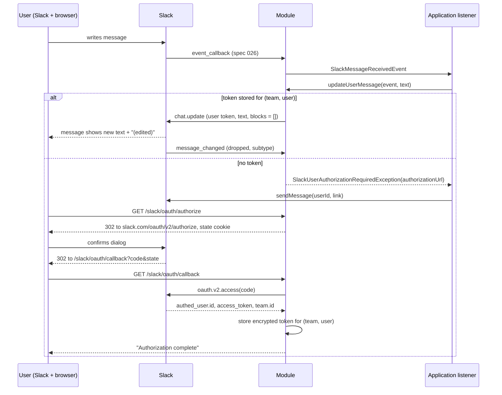

# Design: Editing Slack messages of users

## GitHub Issue

—

## Summary

Spec 026 delivers every message a user writes as a `SlackMessageReceivedEvent`. This spec lets an application change
that message in place: a listener computes a new text (for example the original plus a translation) and calls
`SlackService.updateUserMessage(event, text)`. Slack then shows the user's message with the new text and the
"(edited)" marker, as translation apps for Slack do.

Slack's `chat.update` only changes messages written by the owner of the token. The bot token can therefore never edit
a user's message, not even with admin rights. Each user has to allow it once: the bot sends a link, the user confirms
Slack's authorization dialog, and the module stores a **user token** for that user. Without such a token the edit is
refused with an exception that carries the link, so the application can ask the user.

The feature is opt-in and needs a database table.

## Goals

- In an application, editing the user's message is one call in the listener:

  ```java
  @EventListener
  void on(SlackMessageReceivedEvent message) {
    final String text = message.text() + "\n\n:gb: " + translator.toEnglish(message.text());
    try {
      slackService.updateUserMessage(message, text);
    } catch (SlackUserAuthorizationRequiredException e) {
      slackService.sendMessage(message.userId(), "Allow me to add translations: " + e.authorizationUrl());
    }
  }
  ```
- The OAuth flow that obtains a user token (authorization link, callback, code exchange, storage) is part of the
  module. The application configures it and shares the link; it implements no HTTP endpoint and no storage.
- A user authorizes once, in the browser, with Slack's own dialog. No account and no login in the application.
- User tokens are stored encrypted. They grant the minimal Slack scope `chat:write` and nothing else.
- A token that Slack no longer accepts (revoked, user deactivated, app uninstalled) is deleted; the next edit asks for
  authorization again.
- Editing does not loop: the module's own edits never reach a listener as a new message.
- Nothing changes for applications that do not enable the feature.

## Non-goals

- Editing the bot's own messages (`chat.update` with the bot token). That needs the `ts` that `sendMessage` does not
  return today; a separate, small change.
- Editing messages by other means than replacing the text: blocks, attachments, files.
- Deleting messages, posting as the user, or any other call with the user token.
- Slack token rotation (expiring user tokens with refresh tokens). The Slack app must keep rotation off; see
  "Configuration".
- Sending the authorization link. The application decides how and when to ask (DM, ephemeral message, not at all) and
  how often; the exception only carries the link.
- Rotation of the encryption key.
- An API to list or revoke authorizations from the application.

## Technical approach

### Why a user token

`chat.update` "may only update messages that the calling user has posted". A bot token (`xoxb-…`) is the bot user, so
it can edit only the bot's messages. A user token (`xoxp-…`) of the author can edit the author's messages. A user token
is issued through Slack's OAuth v2 flow with a **user scope** (`user_scope=chat:write`, not `scope=`), separately for
each user and workspace. This is how translation apps for Slack edit messages; their users went through the same dialog
once.

### Flow



The message that triggered the request for authorization is not edited afterwards; the next message is. Retrying the
first one would need the module to remember pending edits, which is out of scope.

### Editing

`SlackService.updateUserMessage(SlackMessageReceivedEvent message, String text)`:

1. Feature not enabled or not configured → `SlackException` (as `sendMessage` without a bot token).
2. Load the token for `(message.teamId(), message.userId())`. None → `SlackUserAuthorizationRequiredException`.
3. `chat.update` with `channel = message.channelId()`, `ts = message.ts()`, `text = text`, `blocks = []` and the user
   token.
4. Slack error `token_revoked`, `invalid_auth`, `account_inactive` or `token_expired` → delete the token, then
   `SlackUserAuthorizationRequiredException`. Any other error → `SlackException` with Slack's error code, as
   `sendMessage` does. Network errors → `SlackException`.

**`blocks = []` is deliberate.** Messages written in the Slack client carry their content as `rich_text` blocks in
addition to `text`. `chat.update` keeps the previous blocks unless the call replaces them, so updating only `text`
would change the notification text but not what is displayed. An empty array removes the blocks; Slack renders `text`
as `mrkdwn`. Formatting survives as far as `text` carries it (`*bold*`, `<@U123>`, links), which is what
`SlackMessageReceivedEvent.text()` contains. This behaviour is verified against a real workspace before merge (see
"Verification").

`SlackService.isUserAuthorized(String teamId, String userId)` answers whether a token is stored, for applications that
want to check before computing an expensive new text. `SlackService.userAuthorizationUrl()` returns the link without
an attempted edit.

`updateUserMessage` does not need the bot token: the user token is passed per request. Sending the link through
`sendMessage` does.

### No loop

An edit makes Slack send a `message` event with subtype `message_changed`. `SlackEventMapper` already drops every event
with a `subtype` (spec 026), so the edit never reaches a listener. A behavior pins this, so that a later change of the
filter cannot introduce a loop unnoticed.

### Authorization endpoints

Two `GET` endpoints below `open-elements.slack.user-authorization.path` (default `/slack/oauth`):

**`/authorize`** — the link the application shares. Generates a random state (32 bytes, URL-safe Base64), sets it as
cookie `slack_oauth_state` (`HttpOnly`, `Secure`, `SameSite=Lax`, `Path=<path>`, `Max-Age=600`) and answers `302` to

```
https://slack.com/oauth/v2/authorize?client_id=…&user_scope=chat:write&redirect_uri=<public-base-url><path>/callback&state=…
```

plus `team=<team-id>` when `open-elements.slack.events.team-id` is set, so Slack preselects the workspace.

**`/callback`** — Slack's redirect target.

1. Query parameter `error` present (for example `access_denied`, the user cancelled) → `400`, nothing stored.
2. `state` missing, cookie missing, or not equal (constant-time compare) → `400`, nothing stored. The cookie is cleared
   in every case.
3. `oauth.v2.access` with `client_id`, `client_secret`, `code` and the same `redirect_uri`. Error → `502`.
4. The response must contain `authed_user.access_token` and `authed_user.scope` must include `chat:write`; otherwise
   `502`. A `refresh_token` in the response means token rotation is on: nothing is stored, `502`, and a warning names
   the cause.
5. If `team-id` is configured and `team.id` differs → `400`, nothing stored.
6. Store `(team.id, authed_user.id) → access_token`, replacing an existing token.
7. `200` with a minimal `text/plain` page: "Slack authorization complete. You can close this window."

The token is stored for the user that Slack reports in `authed_user.id`, never for a user named in the link. Whoever
opens the link can only authorize as themselves; there is no user id in the link to forge.

The state cookie is the CSRF protection: a callback that was not started in the same browser is rejected. No server
state is needed, so it works across instances.

Error responses are RFC 9457 problems built by the `ProblemFactory` when problem details are enabled, and bare status
codes otherwise, as in spec 026:

| Situation | Status | Slug |
| --- | --- | --- |
| Feature enabled but not configured | `503` | `slack-user-authorization-not-configured` |
| User cancelled, state mismatch, foreign workspace | `400` | `slack-user-authorization-rejected` |
| Code exchange failed, scope missing, rotation on | `502` | `slack-user-authorization-failed` |

Logged at `WARN` with the reason; never the code, the token, the state or the cookie.

### Token storage

```java
public interface SlackUserTokenStore {
  Optional<String> find(String teamId, String userId);
  void save(String teamId, String userId, String token);
  void delete(String teamId, String userId);
}
```

A public interface, so an application can replace the storage (`@ConditionalOnMissingBean`). The default is
`JdbcSlackUserTokenStore`:

- **JDBC, not JPA.** Spec 014 keeps every entity in `core` and no optional module owns one. A Slack-specific entity in
  `core` would invert that dependency. `JdbcClient` with parameterized statements is enough for three key-based
  operations, and the core already uses JDBC for its initializers.
- **Table** in the library schema, migration shipped as SQL in the upgrade guide and applied by the application
  (spec 013 contract):

  ```sql
  CREATE TABLE oe_spring_services.slack_user_tokens (
      team_id         VARCHAR(64)  NOT NULL,
      user_id         VARCHAR(64)  NOT NULL,
      encrypted_token BYTEA        NOT NULL,
      created_at      TIMESTAMPTZ  NOT NULL,
      updated_at      TIMESTAMPTZ  NOT NULL,
      PRIMARY KEY (team_id, user_id)
  );
  ```
- **Save is an upsert** (`INSERT … ON CONFLICT (team_id, user_id) DO UPDATE`), so authorizing twice is harmless.
- **Encryption.** AES-256-GCM with a random 12-byte IV per token; stored as `IV || ciphertext+tag`. The key is
  `open-elements.slack.user-authorization.token-encryption-key` (Base64, exactly 32 bytes). `team_id` and `user_id`
  are bound as associated data, so a ciphertext copied to another row does not decrypt. A token that fails to decrypt
  (wrong key, tampered row) is treated as missing and deleted, with a `WARN` that names the row, not the token.

A user token with `chat:write` lets its holder post and edit as that user in every conversation the user can write to.
Encryption keeps a database dump or backup without the key useless.

### Revocation

Lazy: a rejected token is deleted on the next edit (step 4 above). Eager: if the events feature (spec 026) is enabled
and the Slack app subscribes to `tokens_revoked`, the events endpoint deletes the tokens of every listed user of
`event.tokens.oauth`. This event is handled inside the module and not published to listeners. `app_uninstalled` is
not handled: every token is then rejected and deleted lazily.

### Activation

Gated on `open-elements.slack.user-authorization.enabled=true`, like spec 026: the feature opens public paths and
stores credentials, which must be a deliberate decision. When enabled but `client-id`, `client-secret`,
`public-base-url` or a valid `token-encryption-key` is missing, the application starts, logs one warning naming the
missing properties, the endpoints answer `503`, and `updateUserMessage` throws `SlackException`. Start-up does not fail
for the same reason as in spec 026: an optional integration should not take the application down.

A `JdbcClient` (and therefore a `DataSource`) is required for the default store. Without one and without an
application-provided store, start-up fails with a message that names both options — this is a wiring error, not a
missing secret.

### Security chain

`slackUserAuthorizationSecurityFilterChain` (`@Order(0)`, only when an `HttpSecurity` bean exists), matching exactly
`<path>/authorize` and `<path>/callback`: `GET` permitted without authentication, every other method denied, CSRF
disabled (the endpoints only accept `GET` and protect themselves with the state cookie). The chain cannot open any
other path.

### Packages

```
com.openelements.spring.base.slack/
└── SlackUserAuthorizationAutoConfiguration      # new, @ConditionalOnProperty(enabled), servlet web apps
com.openelements.spring.base.services.slack/
├── SlackService                                 # + updateUserMessage, isUserAuthorized, userAuthorizationUrl
└── SlackUserAuthorizationRequiredException      # extends SlackException, carries authorizationUrl()
com.openelements.spring.base.services.slack.authorization/
├── SlackUserAuthorizationProperties             # open-elements.slack.user-authorization.*
├── SlackUserAuthorizationEndpoint               # RouterFunction: /authorize, /callback
├── SlackUserTokenStore                          # public SPI
├── JdbcSlackUserTokenStore                      # default
├── SlackTokenCipher                             # AES-GCM
└── SlackUserAuthorizationProblemType
```

As in spec 026, the new classes carry no stereotype annotation (`SlackConfig` scans `services.slack` and its
sub-packages), so the property gate cannot be bypassed. `SlackService` gets the user-authorization collaborators
through `ObjectProvider`s and works unchanged when the feature is off.

### Configuration

| Property | Default | |
| --- | --- | --- |
| `open-elements.slack.user-authorization.enabled` | `false` | opt-in |
| `open-elements.slack.user-authorization.client-id` | — | Slack app → Basic Information |
| `open-elements.slack.user-authorization.client-secret` | — | from secret management only, never logged |
| `open-elements.slack.user-authorization.public-base-url` | — | e.g. `https://app.example.com`; the callback URL is derived from it and must be registered in the Slack app |
| `open-elements.slack.user-authorization.path` | `/slack/oauth` | |
| `open-elements.slack.user-authorization.token-encryption-key` | — | Base64, 32 bytes; from secret management only |

The workspace restriction reuses `open-elements.slack.events.team-id`; a second property for the same fact would drift.

Slack app setup (documented, not code): under *OAuth & Permissions* add the redirect URL
`<public-base-url>/slack/oauth/callback` and the **user** token scope `chat:write`; keep *Token Rotation* off.
Optionally subscribe to the bot event `tokens_revoked`.

### Verification

Before merge, against a real Slack workspace (as spec 015 did against Authentik), recorded in `steps.md`:

- A message written in the desktop client with bold text, a mention and a link is edited; the displayed message shows
  the new text with formatting and "(edited)".
- A message with an attached file keeps the file after the edit.
- The edit produces a `message_changed` event and no listener call.
- Revoking the authorization in Slack leads to `token_revoked` on the next edit and the token row is gone.

## Alternatives considered

- **Bot token only.** Impossible; Slack refuses `chat.update` on messages of other users (`cant_update_message`).
- **Reply in a thread instead of editing.** Needs no user token and no storage and would be a fine fallback, but it is
  not what was asked: the original message stays unchanged and the translation is one click away. Can be built by the
  application with `sendMessage` once threads are supported.
- **Delete the user's message and repost it as the bot.** Needs the user token as well, loses the author, the
  timestamp and reactions.
- **Storage left to the application (SPI only).** Smaller, but every application would write the same table, the same
  encryption and the same revocation handling. The SPI stays for applications that need another store.
- **JPA entity in `core`.** Contradicts spec 014: an optional module's data would live in `core`.
- **Server-side state for the OAuth `state`.** Works, but needs storage and expiry and breaks across instances without
  sharing. A cookie compared with the parameter needs neither.
- **Token rotation support.** Refresh logic, expiry handling and concurrent refreshes for a setting that is off by
  default in Slack apps. Rejected for now; a stored token with rotation on would stop working after 12 hours, hence the
  explicit refusal at the callback.

## Open questions

- **Success page.** A plain text page is enough to close the tab. An application may want its own page or a redirect
  back into Slack (`slack://open`); a `success-redirect-url` property can be added when someone needs it.
- **Key rotation.** Changing the key makes every stored token unreadable; they are deleted on use and users authorize
  again. Acceptable for now, recorded in `docs/TODO.md` when implemented.
